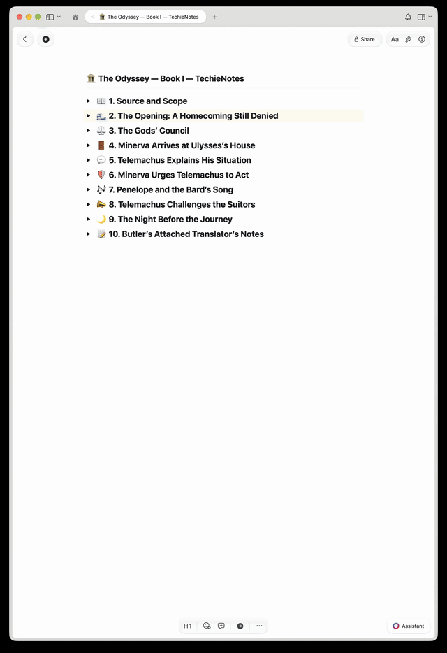

# 📝 TechieNotes

**Turn books, articles, transcripts, lessons, and other source material into clear, hierarchical notes.**

TechieNotes is an AI skill that reads your material, infers its topics and categories, and breaks it down into **headings, subheadings, and concise bullets**. The AI works out which ideas belong together and how they relate, so you don’t have to provide an outline first.

It adds visual structure to make the notes easier to scan and review:

- **Numbered headings** show the hierarchy: `1.`, `1.1.`, `1.1.1.`, and so on.
- **Emojis at the beginning of each heading and text block** signal the topic or purpose.
- **Bold keywords and key phrases** make important terms stand out.
- **Collapsible headings** let you expand the detail you want to read.

The skill condenses repetition while preserving the source’s meaning, important details, examples, and qualifications. Code and commands stay unchanged.

## Demo



## Works with Craft—and can be adapted

This version creates notes in **Craft**, with the entire hierarchy inside one document. Headings, subheadings, and indentation organize the content without creating separate subpages.

It can also be easily retrofitted for **Notion, Obsidian, and other note-taking apps**. Keep the rules for organizing and condensing the material, then adapt the formatting and publishing instructions to the destination—for example, Notion blocks or Markdown files in an Obsidian vault.

## Install

### In Codex

Ask Codex to install the skill by pasting this prompt into a chat:

```text
Use skill-installer to install the skill from:
https://github.com/Techienaut/TechieNotes/tree/main/skills/techienotes-craft
```

Once installed, it should be available automatically. If it doesn’t appear, restart Codex. See the [official skill installation guide](https://learn.chatgpt.com/docs/build-skills#install-curated-skills-for-local-use).

For a manual installation, download this repository and copy the entire `skills/techienotes-craft` folder into `~/.agents/skills/`. Keep `SKILL.md`, `agents/`, and `references/` together. Other compatible agents may use a different skills folder.

### Connect Craft

To publish directly, connect Craft to your AI agent through a Craft connector or MCP/API integration. You can also request a Markdown file without connecting Craft.

## Use it

Provide your source text, file, or accessible link, then say what you want covered and where to save it. For example:

> Use techienotes-craft to turn the first chapter of this book into hierarchical notes and publish them in Craft.

Or:

> Use techienotes-craft to organize this transcript into notes. Return a Markdown file.

## Contribute

Contributions are welcome, including clearer instructions, better categorization and formatting, bug fixes, sample notes, and adaptations for other note-taking apps.

- **Report a problem or suggest an idea:** [Open an issue](https://github.com/Techienaut/TechieNotes/issues). Include a short source example, the result you got, and what you expected.
- **Improve the skill:** Fork the repository, make your changes on a branch, and [open a pull request](https://github.com/Techienaut/TechieNotes/pulls).
- **Show the improvement:** Try your change on a representative source and include before-and-after notes or screenshots in your pull request.
- **Add support for another app:** Explain the required connection or setup and show how headings, indentation, emojis, and bold text are preserved.

The main instructions live in [SKILL.md](skills/techienotes-craft/SKILL.md). Supporting workflows cover [Craft publishing](skills/techienotes-craft/references/craft-delivery.md) and [long sources](skills/techienotes-craft/references/long-source-workflow.md).
